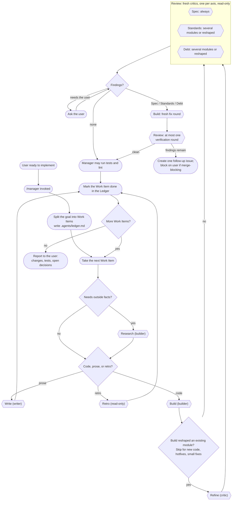
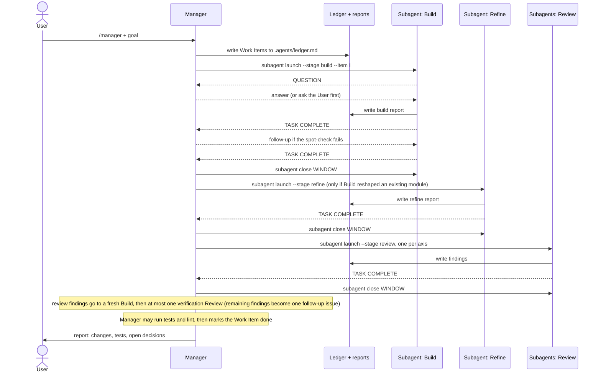

# Agent workflow

How a goal moves from the user's request to a changed, reviewed branch. Terms
are defined in [GLOSSARY.md](../GLOSSARY.md); the decisions behind this shape
are [ADR 0003](adr/0003-subagent-is-a-stage-instance.md),
[ADR 0006](adr/0006-manager-always-delegates.md), and
[ADR 0007](adr/0007-bash-launcher-rex-only.md).

## Flow

Rounded boxes run in the Manager's own session. Hexagons are Subagents: each
is a fresh session for one Stage of one Work Item, started by
`subagent launch --stage <stage>` in a local Rex window.

Defaults the flow leaves implicit:

- The Manager is invoked only when the user is ready to implement. Shaping,
  design, diagnosis, planning, and shipping happen outside it.
- Review follows Build (and Refine when Refine ran), never Write or Retro. Spec
  always runs. Standards and Debt run in parallel with Spec when the change
  spans several modules or reshapes one.
- Retro runs a read-only retrospective of a session and writes one report; it
  never edits code and skips Review.
- Refine is a standalone `zero-tech-debt` cleanup pass on an existing Work Item
  diff, never a fix round for Review findings. All Review findings (Spec,
  Standards, and Debt) go to a fresh Build Subagent.
- Verification after a fix round runs one Review scoped to the original
  findings (never `r3`/`r4` Review rounds); if findings remain, non-blocking
  ones become one follow-up issue before merge, while merge-blocking ones get
  at most one targeted final Build round verified by the Manager (or a
  follow-up issue and `blocked on user` if any repro still fails).
- Pre-existing bugs that already behaved the same on `main` become separate
  follow-up Work Items instead of blocking the merge.
- Every round uses fresh Subagents. A follow-up before the Manager accepts a
  report goes to the same Subagent.
- Work Items on disjoint code run in parallel, each in its own worktree.
  Overlapping Work Items run one after another in one worktree. The Manager
  merges each finished branch.
- At most one Subagent edits a worktree at a time. Read-only Stages (Research,
  Review, Retro) share it.
- Each Stage's default Model profile (harness, model, and thinking effort for
  builder, writer, or critic) is fixed in the Stage and profile tables of
  `agents/skills/subagents/scripts/subagent`. The Manager keeps those defaults
  unless the user explicitly asks to override `--harness`, `--model`, or
  `--effort`.
- The Manager closes a Subagent's window when its report is accepted.
- The Manager asks the user instead of looping when a decision belongs to the
  user, when a remaining finding blocks merge after verification, or when
  reviewers disagree with the spec itself.

Some Stage skills (grilling, tdd, review, zero-tech-debt and others) are not in
this repository: they come from the shared checkout at `~/work/prefapp/skills`.
`ls -l ~/.agents/skills` shows which checkout supplies each installed skill, and
`just doctor` reports repo-owned links that dangle.

## Sessions

Every Subagent talks only to the Manager; the user talks only to the Manager.
Sessions hand work over through files: the brief going in on stdin to
`subagent launch`, the report coming out at
`.agents/reports/<item>-<stage>[-<axis>].md`, the diff in the worktree, and the
Ledger at `.agents/ledger.md`. All messages between the Manager and Subagents
travel over recado on this machine.

