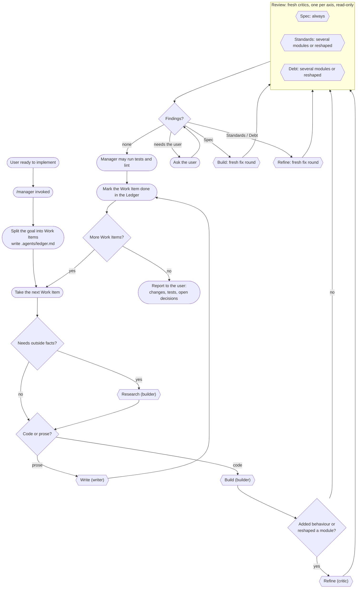
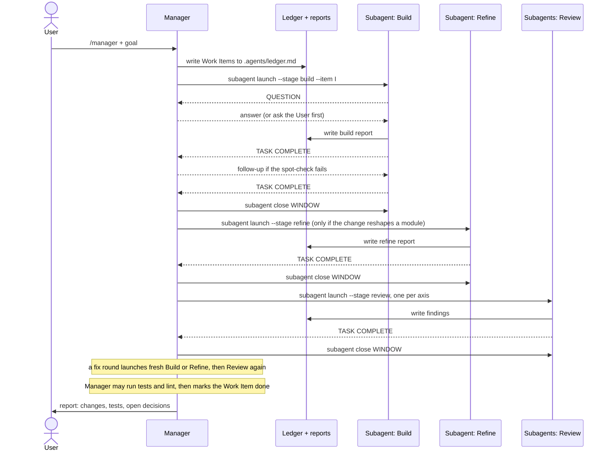

# Agent workflow

How a goal moves from the user's request to a changed, reviewed branch. Terms
are defined in [GLOSSARY.md](../GLOSSARY.md); the decisions behind this shape
are [ADR 0003](adr/0003-subagent-is-a-stage-instance.md),
[ADR 0006](adr/0006-manager-always-delegates.md), and
[ADR 0007](adr/0007-bash-launcher-rex-only.md).

## Flow

Rounded boxes run in the Manager's own session. Hexagons are Subagents: each
is a fresh session for one Stage of one Work Item, started by
`subagent launch --stage <stage>` in a local Rex window.

Defaults the flow leaves implicit:

- The Manager is invoked only when the user is ready to implement. Shaping,
  design, diagnosis, planning, and shipping happen outside it.
- Review follows every round that wrote code, Build or Refine, and never
  follows Write. Spec always runs. Standards and Debt run when the change spans
  several modules or reshapes one.
- Every round uses fresh Subagents. A follow-up before the Manager accepts a
  report goes to the same Subagent.
- Work Items on disjoint code run in parallel, each in its own worktree.
  Overlapping Work Items run one after another in one worktree. The Manager
  merges each finished branch.
- At most one Subagent edits a worktree at a time. Review Subagents only read,
  so they share it.
- Each Stage's model profile (builder, writer, or critic) is fixed in the Stage
  table of `agents/skills/subagents/scripts/subagent`.
- The Manager closes a Subagent's window when its report is accepted.
- The Manager asks the user instead of looping when a decision belongs to the
  user, when a finding comes back after its fix, or when reviewers disagree
  with the spec itself.

Some Stage skills (grilling, tdd, review, zero-tech-debt and others) are not in
this repository: they come from the shared checkout at `~/work/prefapp/skills`.
`ls -l ~/.agents/skills` shows which checkout supplies each installed skill, and
`just doctor` reports repo-owned links that dangle.

## Sessions

Every Subagent talks only to the Manager; the user talks only to the Manager.
Sessions hand work over through files: the brief going in on stdin to
`subagent launch`, the report coming out at
`.agents/reports/<item>-<stage>[-<axis>].md`, the diff in the worktree, and the
Ledger at `.agents/ledger.md`. All messages between the Manager and Subagents
travel over recado on this machine.

